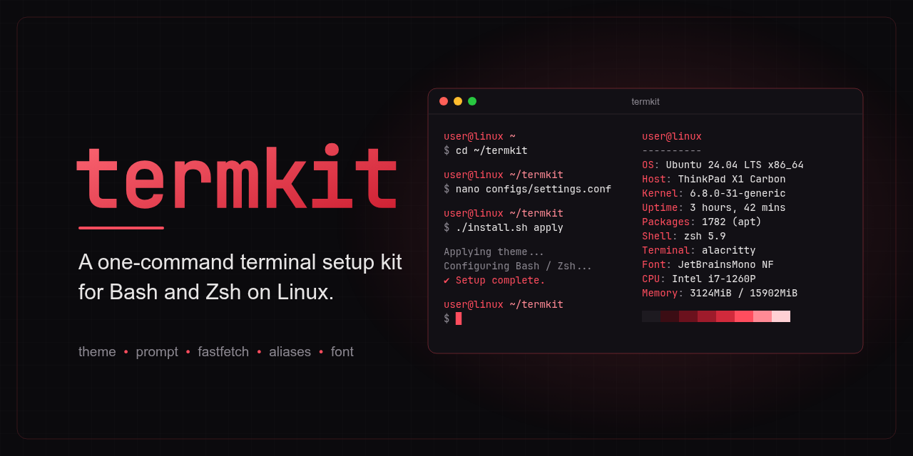
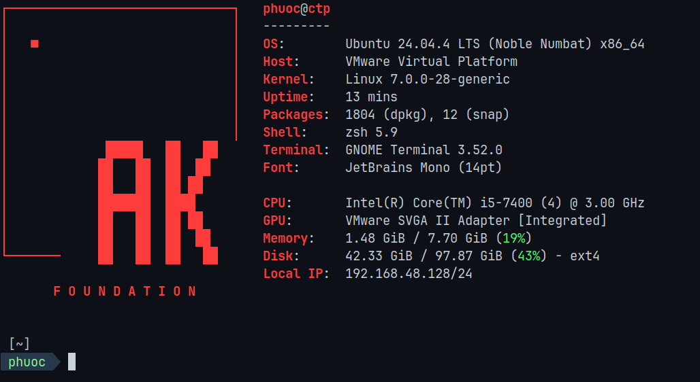

<div align="center">


</div>

<p align="center">
  
  
  
  
</p>

# Termkit - Terminal Setup Kit for Linux

<center>
</center>

<hr>

## Demo

<div align="center">
  
</div>
<p align="center"><strong><em>Figure 1:</em></strong> Shipped <code>ak</code> preset (Nerd Font + fastfetch + two-line agnoster prompt)</p>

## Documentation

| File | Description |
| --- | --- |
| [README.md](README.md) | Main project overview, quick start, commands, repo layout, and uninstall. |
| [docs/00-guide-setup.md](docs/00-guide-setup.md) | Install prerequisites (bash, zsh, oh-my-zsh, plugins, fastfetch, fontconfig) for each target shell. |
| [docs/01-guide-settings.md](docs/01-guide-settings.md) | `settings.conf` schema and what the `apply` command does to your shell rc. |
| [docs/02-guide-extending.md](docs/02-guide-extending.md) | Add your own theme, font, or logo to the kit. |
| [docs/03-guide-ak-sample.md](docs/03-guide-ak-sample.md) | Walkthrough of the shipped `ak` preset with a piece-by-piece breakdown of `ak.zsh-theme` so you can fork it into your own. |

## Introduction

Termkit is a small toolkit for configuring Linux terminals, a practical way to keep a consistent prompt, logo, aliases, and font across both bash and zsh with a single command. While using Termkit, you rely on the following core building blocks:

- **State file:** A single `configs/settings.conf` captures every choice you have made.
- **Managed block:** Termkit only writes a fenced block into `~/.bashrc` or `~/.zshrc`; the rest of the file is untouched.
- **Reversible:** Every apply is idempotent; a single `uninstall` command wipes the block and any files Termkit installed.

### I. Quick Start

Once prerequisites are installed (see [docs/00-guide-setup.md](docs/00-guide-setup.md)):

```
git clone https://github.com/caotrongphuoc/termkit.git ~/termkit
cd ~/termkit
nano configs/settings.conf     # or your editor: pick shell, theme, logo, aliases
./install.sh apply
```

Then open a new terminal to see changes. To undo: `./install.sh uninstall`.

For a ready-to-paste preset, see [docs/03-guide-ak-sample.md](docs/03-guide-ak-sample.md).

> **Note:** New here? Read the docs in order. **00** installs prereqs, **01** explains the schema, **02** shows how to add your own, **03** walks through the shipped preset piece by piece.

### II. Commands

<div align="center">

| Command | What it does |
| --- | --- |
| `./install.sh apply` | Reads settings.conf and applies to your shell rc. |
| `./install.sh status` | Prints current settings.conf values. |
| `./install.sh clean` | Resets settings.conf from `settings.default.conf` (old file kept as `.bak`). |
| `./install.sh uninstall` | Removes Termkit changes from both `~/.bashrc` and `~/.zshrc`. |
| `./install.sh` | Prints usage. |

</div>

### III. Repo Layout

```
termkit/
├── install.sh
├── configs/
│   ├── settings.conf              # your picks live here
│   ├── settings.default.conf      # defaults restored by install.sh clean
│   ├── themes/{bash,zsh}/         # shell prompts
│   ├── fonts/*.ttf                # copied to ~/.local/share/fonts when enabled
│   ├── logo/*.txt                 # printed on shell start when enabled
│   ├── fastfetch/*.jsonc          # copied to ~/.config/fastfetch/config.jsonc when set
│   └── aliases.sh                 # sourced when aliases are enabled
└── docs/
    ├── 00-guide-setup.md
    ├── 01-guide-settings.md
    ├── 02-guide-extending.md
    └── 03-guide-ak-sample.md
```

### IV. Uninstall

`./install.sh uninstall`:

- Removes the managed block from both `~/.bashrc` and `~/.zshrc` (whichever has it).
- Removes fonts under `~/.local/share/fonts/` matching files in `configs/fonts/`.
- Removes files under `~/.oh-my-zsh/custom/themes/` matching `configs/themes/zsh/*.zsh-theme`.

Fonts and themes from other sources are left alone. Backups at `~/.bashrc.termkit.bak` and `~/.zshrc.termkit.bak` are kept. To fully revert:

```
cp ~/.bashrc.termkit.bak ~/.bashrc
cp ~/.zshrc.termkit.bak  ~/.zshrc
```

## Contact & Support

<p style="font-size: 20px;"><strong>Cao Trong Phuoc</strong> - Software Engineer</p>

``` Note
Thank you for visiting this repository.
If you have any questions, suggestions, or feedback about this project or terminal customization, feel free to contact me directly.
```

<a href="https://github.com/caotrongphuoc">
  
</a>

<a href="https://www.linkedin.com/in/cao-trong-phuoc/">
  
</a>
